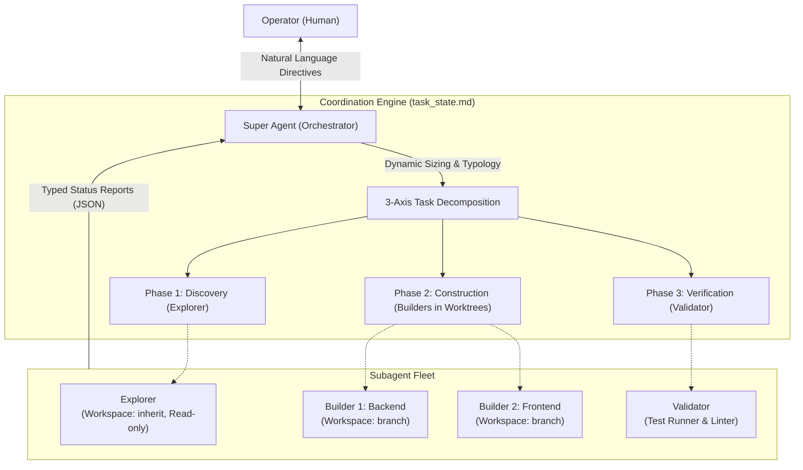

# Super Orchestrator Skill

> Dynamic multi-agent decomposition and coordination protocol for long-horizon autonomous software engineering and research tasks across Claude Code, OpenAI Codex, Cline, VS Code Copilot, OpenCode, and Antigravity.

`super-orchestrator` is an agentic orchestration skill designed for a **Single Human $\leftrightarrow$ Single Super Agent $\leftrightarrow$ Multi-Subagent** operational model. It abstracts and generalizes the multi-agent control principles introduced in [DeepSeek Super Agent](https://github.com/deepseek-ai/dsh-superagent-prototype) into a standalone, lightweight agent skill that requires no proprietary runtime harnesses or enterprise ticketing databases.

---

## 1. Core Architecture

The architecture separates strategic task formulation, human interface, and boundary enforcement (the **Super Agent**) from tactical execution in isolated environments (specialized **Subagents**).



### Key Innovations

1. **Lazy Dynamic Decomposition**: When an unknown runtime task is presented, the Super Agent does not use hardcoded subagent counts. It evaluates the task against a **3-Axis Decomposition Matrix**:
   - **File Coupling**: Are target files disjoint or overlapping? (Prevents concurrent write conflicts).
   - **Dependency Graph (DAG)**: Can tasks run concurrently or must they execute in a staged pipeline?
   - **Context Load**: Offloads high-churn operations (AST grep, multi-file inspection, test logs) to throwaway subagents to keep the parent context window clean.
2. **Minimal Viable Delegation & The Rule of 3**:
   - Defaults to **1 subagent** for straightforward tasks to eliminate unnecessary coordination tax.
   - Enforces a hard ceiling of **at most 3 concurrent write subagents (`Builders`)** to ensure Git branch convergence remains mathematically tractable.
3. **Canonical Subagent Typology**:
   - `Explorer`: Broad codebase mapping, search, and factual discovery (read-only, `Workspace: 'inherit'`).
   - `Builder`: Concrete code generation and refactoring in an isolated Git worktree branch (`Workspace: 'branch'`).
   - `Validator`: Automated test suite execution, regression verification, and linter validation.
   - `Synthesizer`: Technical documentation, architectural diagrams, and final integration reporting.
4. **Decoupled Asynchronous Protocol**:
   - Subagents emit typed reports: `progress`, `ready`, `blocked`, `failed`, or `handback`.
   - The Super Agent never polls in a loop; modern agent harnesses reactively resume the parent turn when child events occur.
   - Subagents exceeding their mandate trigger an explicit `handback` rather than expanding scope unilaterally.

---

## 2. Directory Structure

```text
super-orchestrator/
├── SKILL.md                          # Main skill runbook and orchestration protocol
├── references/
│   ├── decomposition_matrix.md       # Decision tree for task sizing and DAG sequencing
│   ├── subagent_templates.md         # System prompts for Explorer, Builder, Validator, Synthesizer
│   ├── coordination_protocol.md      # Structured reporting & steering message schemas
│   └── agent_integration_guide.md    # Guide for Claude Code, Codex, Cline, VS Code, Grok, etc.
└── scripts/
    └── plan_task.py                  # CLI utility for checking file disjointness and worktrees
```

---

## 3. Multi-Agent Ecosystem Compatibility

The orchestration principles are fully runtime-agnostic. The protocol relies exclusively on Git worktrees, Markdown state tracking (`task_state.md`), and typed message exchanges.

### Compatibility & Integration Recipes

| Coding Agent | Integration Hook | Subagent Primitive | Workspace Isolation |
| :--- | :--- | :--- | :--- |
| **Google Antigravity (`agy`)** | `skills/super-orchestrator/SKILL.md` | Native `invoke_subagent` | `Workspace: 'branch'` |
| **Anthropic Claude Code** | `~/.claude/skills/` or `CLAUDE.md` | `Agent` tool / Task Spawning | `git worktree add` via bash |
| **OpenAI Codex / Codex CLI** | `AGENTS.md` / Custom Instructions | Sub-process invocation / Swarm | Git worktrees via terminal |
| **Cline (VS Code)** | `.clinerules` | Custom Modes (Architect $\rightarrow$ Code) | MCP Worktree Server or Git CLI |
| **VS Code Copilot / Workspace** | `.github/copilot-instructions.md` | Multi-File Task Planner / `@workspace` | Git branch isolation |
| **OpenCode / Meta Muse / Grok** | System Prompt / Runbook markdown | Autonomous background jobs | Worktree branches via shell |

#### 1. Anthropic Claude Code Setup
Copy the skill to `~/.claude/skills/super-orchestrator/` and add to your `CLAUDE.md`:
```markdown
When executing multi-stage or long-running tasks:
1. Load ~/.claude/skills/super-orchestrator/SKILL.md.
2. Evaluate file coupling and maintain task state in `task_state.md`.
3. Isolate code modifications using git worktrees: `git worktree add -b agent/<subtask> .worktrees/<subtask>`.
4. Enforce the Rule of Three: maximum 3 concurrent worktree branches.
```

#### 2. OpenAI Codex / Codex CLI Setup
In your global or project `AGENTS.md`:
```markdown
## Long-Horizon Multi-Agent Orchestration
For complex refactoring, multi-module features, or comprehensive test suites:
- Follow the 3-axis task decomposition matrix in `references/decomposition_matrix.md`.
- Before executing code edits, generate a structured decomposition plan in `task_state.md`.
- For every parallel worker, provision a separate Git worktree under `.worktrees/`.
- Never allow parallel write workers to touch overlapping files.
```

#### 3. Cline (VS Code Autonomous Coding Agent)
Create a `.clinerules` file in your repository root:
```markdown
When assigned a large or complex task:
1. Switch to 'Architect' mode to evaluate file coupling and generate `task_state.md`.
2. Use terminal commands to create isolated worktrees for subtasks:
   `git worktree add -b agent/<feature> .worktrees/<feature>`
3. Execute implementation within the worktree directory.
4. Run `python scripts/plan_task.py check-overlap --plan-json <plan.json>` before merging.
```

#### 4. GitHub Copilot & VS Code Copilot Workspace
Add the orchestration rules to `.github/copilot-instructions.md`:
```markdown
# Task Orchestration Rules
- When asked to perform complex, multi-file engineering tasks, act as a Super Orchestrator.
- Decompose tasks into Discovery (Explorer), Construction (Builder), and Verification (Validator).
- Document active phases in `task_state.md`.
- Restrict Builders to disjoint directory trees to avoid merge conflicts.
```

#### 5. OpenCode, Meta Muse, and xAI Grok Bot
Pass `SKILL.md` directly via system prompt flags or automated shell execution:
```bash
# Provision isolated worktree
git worktree add -b agent/auth-refactor .worktrees/auth-refactor

# Run autonomous agent inside isolated worktree
cd .worktrees/auth-refactor && run_agent --prompt "Implement JWT validation"

# Merge and clean up
cd ../.. && git merge agent/auth-refactor && git worktree remove .worktrees/auth-refactor
```

For full details, see [references/agent_integration_guide.md](references/agent_integration_guide.md).

---

## 4. Installation & Platform Setup

### In Anthropic Claude Code
```bash
mkdir -p ~/.claude/skills/super-orchestrator
cp -r * ~/.claude/skills/super-orchestrator/
```

### In Google Antigravity (`agy`)
```bash
# Global installation
cp -r . ~/.gemini/antigravity-cli/skills/super-orchestrator/

# Or workspace-specific installation
mkdir -p .agents/skills/super-orchestrator/
cp -r * .agents/skills/super-orchestrator/
```

### In OpenAI Codex / Codex CLI
Reference the runbook in your global `AGENTS.md`:
```bash
cat << 'EOF' >> ~/.codex/AGENTS.md
# Super Orchestrator Protocol
For multi-stage tasks, follow ~/.codex/skills/super-orchestrator/SKILL.md.
EOF
```

### In Cline (VS Code)
Symlink or copy the skill directory and add the `.clinerules` snippet from [references/agent_integration_guide.md](references/agent_integration_guide.md).

---

## 5. Usage

Trigger the skill in natural language across any supported agent:

```text
Using the super-orchestrator skill, audit our codebase for OWASP agentic AI vulnerabilities, 
refactor the authentication middleware to use JWT with RS256, and verify all test suites pass.
```

The Super Agent will:
1. Generate an internal `task_state.md` plan.
2. Spawn an `Explorer` to map authentication routes.
3. Spawn a `Builder` in an isolated Git worktree branch (`agent/jwt-auth`).
4. Spawn a `Validator` to execute unit and regression suites.
5. Merge the verified branch and present a complete deliverable summary.

---

## 6. References & Prior Art

- **DeepSeek AI (2026).** *Exploring Super-agent Design: Towards a More Autonomous Agent System.* [deepseek-ai/dsh-superagent-prototype](https://github.com/deepseek-ai/dsh-superagent-prototype).
- **Ken Huang (2026).** *Harness Engineering: Design Patterns for Securing Long-Horizon Multi-Agent AI Systems.* Amazon Kindle.
- **Ken Huang (2026).** *Graph Engineering for Agentic AI Systems.* Amazon Kindle.

---

## 7. License

MIT License. See [LICENSE](LICENSE) for details.
