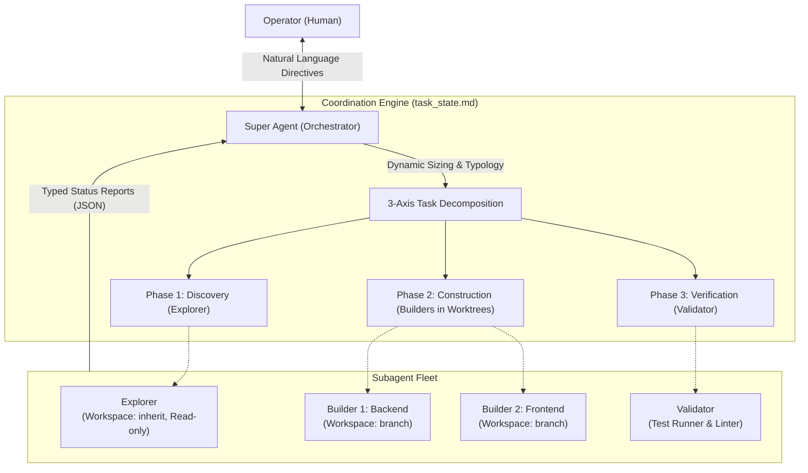

# Super Orchestrator Skill

> Dynamic multi-agent decomposition and coordination protocol for long-horizon autonomous software engineering and research tasks in Google Antigravity (`agy`).

`super-orchestrator` is an agentic orchestration skill designed for a **Single Human $\leftrightarrow$ Single Super Agent $\leftrightarrow$ Multi-Subagent** operational model. It abstracts and generalizes the multi-agent control principles introduced in [DeepSeek Super Agent](https://github.com/deepseek-ai/dsh-superagent-prototype) into a standalone, lightweight agent skill that requires no proprietary runtime harnesses or enterprise ticketing databases.

---

## 1. Core Architecture

The architecture separates strategic task formulation, human interface, and boundary enforcement (the **Super Agent**) from tactical execution in isolated environments (specialized **Subagents**).



### Key Innovations

1. **Lazy Dynamic Decomposition**: When an unknown runtime task is presented, the Super Agent does not use hardcoded subagent counts. It evaluates the task against a **3-Axis Decomposition Matrix**:
   - **File Coupling**: Are target files disjoint or overlapping? (Prevents concurrent write conflicts).
   - **Dependency Graph (DAG)**: Can tasks run concurrently or must they execute in a staged pipeline?
   - **Context Load**: Offloads high-churn operations (AST grep, multi-file inspection, test logs) to throwaway subagents to keep the parent context window clean.
2. **Minimal Viable Delegation & The Rule of 3**:
   - Defaults to **1 subagent** for straightforward tasks to eliminate unnecessary coordination tax.
   - Enforces a hard ceiling of **at most 3 concurrent write subagents (`Builders`)** to ensure Git branch convergence remains mathematically tractable.
3. **Canonical Subagent Typology**:
   - `Explorer`: Broad codebase mapping, search, and factual discovery (read-only, `Workspace: 'inherit'`).
   - `Builder`: Concrete code generation and refactoring in an isolated Git worktree branch (`Workspace: 'branch'`).
   - `Validator`: Automated test suite execution, regression verification, and linter validation.
   - `Synthesizer`: Technical documentation, architectural diagrams, and final integration reporting.
4. **Decoupled Asynchronous Protocol**:
   - Subagents emit typed reports: `progress`, `ready`, `blocked`, `failed`, or `handback`.
   - The Super Agent never polls in a loop; Antigravity reactively resumes the parent turn when child events occur.
   - Subagents exceeding their mandate trigger an explicit `handback` rather than expanding scope unilaterally.

---

## 2. Directory Structure

```text
super-orchestrator/
├── SKILL.md                          # Main skill runbook and orchestration protocol
├── references/
│   ├── decomposition_matrix.md       # Decision tree for task sizing and DAG sequencing
│   ├── subagent_templates.md         # System prompts for Explorer, Builder, Validator, Synthesizer
│   └── coordination_protocol.md      # Structured reporting & steering message schemas
└── scripts/
    └── plan_task.py                  # CLI utility for checking file disjointness and worktrees
```

---

## 3. Installation

### In Google Antigravity (`agy`)
Clone or copy this directory into your Antigravity skills path:

```bash
# Global installation
cp -r super-orchestrator ~/.gemini/antigravity-cli/skills/

# Or workspace-specific installation
mkdir -p .agents/skills/
cp -r super-orchestrator .agents/skills/
```

Once installed, Antigravity discovers the skill automatically via progressive disclosure.

---

## 4. Usage

Trigger the skill in natural language:

```text
Using the super-orchestrator skill, audit our codebase for OWASP agentic AI vulnerabilities, 
refactor the authentication middleware to use JWT with RS256, and verify all test suites pass.
```

The Super Agent will:
1. Generate an internal `task_state.md` plan.
2. Spawn an `Explorer` to map authentication routes.
3. Spawn a `Builder` in an isolated Git worktree branch (`agent/jwt-auth`).
4. Spawn a `Validator` to execute unit and regression suites.
5. Merge the verified branch and present a complete deliverable summary.

---

## 5. References & Prior Art

- **DeepSeek AI (2026).** *Exploring Super-agent Design: Towards a More Autonomous Agent System.* [deepseek-ai/dsh-superagent-prototype](https://github.com/deepseek-ai/dsh-superagent-prototype).
- **Ken Huang (2026).** *Harness Engineering: Design Patterns for Securing Long-Horizon Multi-Agent AI Systems.* Amazon Kindle.
- **Ken Huang (2026).** *Graph Engineering for Agentic AI Systems.* Amazon Kindle.

---

## 6. License

MIT License. See [LICENSE](LICENSE) for details.
