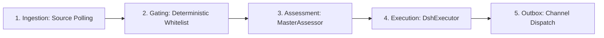

# DeepSeek Super Agent Code Review: Deconstructing Multi-Developer Repositories, Asynchronous Worktrees, and the Single-Operator Orchestrator Skill

### Analyzing the 5-Stage Event Engine in `dsh-superagent`, Porting Decoupled Agent Presets to Antigravity, and Managing Dynamic Long-Horizon Workloads

By **Ken Huang**, Adjunct Professor, University of San Francisco (USF)

DeepSeek published <a href="https://github.com/deepseek-ai/dsh-superagent-prototype" target="_blank">dsh-superagent-prototype</a> as an experimental implementation of an autonomous software engineering agent system operating over a shared Git repository. While marketing narratives frequently frame coding agents as interactive terminal chatbots, DeepSeek's prototype presents a different architectural paradigm: an event-driven daemon that treats code repositories as persistent event streams, executes tasks across isolated Git worktrees, and enforces deterministic admission gates before allowing large language models to spend inference compute.

This technical analysis reviews the internal TypeScript codebase of `dsh-superagent`, unpacks its five-stage event pipeline, examines its concurrency model for multi-developer teams on GitHub, and demonstrates how we extracted its core coordination invariants into a lightweight, public Antigravity (`agy`) skill published at <a href="https://github.com/kenhuangus/super-orchestrator" target="_blank">kenhuangus/super-orchestrator</a>. We analyze how removing multi-tenant ticketing bureaucracy while preserving isolated worktree execution and asynchronous reactive messaging enables a single human operator to orchestrate dynamic, long-horizon engineering tasks.

The free preview below details the engineering stakes and roadmap. The complete architectural audit, state machine derivations, code block walkthroughs, and Antigravity implementation follow below the paywall.

### Article Roadmap
1. **Section 1: The Five-Stage Event Pipeline in `dsh-superagent`** establishes why deterministic admission gates must decouple event ingestion from language model inference.
2. **Section 2: Multi-Developer Concurrency and GitHub Event Ingestion** evaluates how thread-scoped polling, CLI shims, and immutable mandates prevent concurrent write contamination across teams.
3. **Section 3: The Two-Tier Decoupled Agent Topology** details why orchestrator sessions must never execute shell commands or wait synchronously on worker turns.
4. **Section 4: Abstracting the Workflow: From Enterprise Ticketing to Single-Operator Orchestration** explains why individual operators do not need database-backed tickets but require structured task contracts for context window preservation.
5. **Section 5: Dynamic Decomposition for Unknown Long-Horizon Workloads** introduces the 3-axis decomposition matrix and the Rule of Three concurrency ceiling for Antigravity subagents.
6. **Section 6: Implementation of the `super-orchestrator` Skill** presents the production skill runbook, subagent archetypes, and verification tooling.

<!-- Substack Paywall -->

## Section 1: The Five-Stage Event Pipeline in `dsh-superagent`

The architecture of `dsh-superagent` departs from standard agentic patterns that connect an interactive read-eval-print loop directly to a model endpoint. Instead, the system models repository operations as a discrete event-processing pipeline divided into five stages: Ingestion, Gating, Assessment, Execution, and Outbox Transmission.



*Figure 1: The five-stage pipeline in dsh-superagent separating event intake from model execution.*

### 1. Ingestion (`src/core/intake.ts`)
Event sources in `dsh-superagent` are continuous streams. The GitHub source implementation in `src/sources/github.ts` polls notifications, subscribed pull requests, review comment threads, and commit status updates at two-second intervals. Every inbound event is normalized into an immutable `Trigger` object. Each trigger belongs to a `Thread` (such as a GitHub issue number or pull request conversation), establishing an append-only audit trail before any business logic evaluates the payload.

### 2. Deterministic Gating (`src/core/evals.ts`)
A fatal vulnerability in autonomous repository agents is denial-of-wallet attacks and prompt injection via public repository interactions. If an agent calls an LLM every time a user comments on an issue, an unauthorized user can exhaust API quotas or inject malicious instructions into the agent prompt. 

DeepSeek addresses this through a zero-token deterministic gate. The gate verifies:
- The actor's GitHub login against an explicit whitelist stored in `policy.sources.github.allowed`.
- The origin message type against permitted trigger classes.
- Whether the actor is an automated bot or continuous integration system.

If the actor fails the gate, the trigger is marked `filtered` and stored without ever waking an LLM session or allocating worker memory.

### 3. Master Assessment (`src/app/assessment.ts`)
Triggers passing the gate enter the assessment queue. The orchestrator session (`dsh-superagent-router`) activates the `MasterAssessor`. The assessor reads the surrounding conversation window through bounded tools (`orchestrator_eval_read`) and evaluates whether the request constitutes actionable work.

The model emits a strictly validated Zod schema (`AssessmentSchema` in `src/app/assessment.ts`):

```typescript
    export const AssessmentSchema = z.object({
      decision: z.enum(['accept', 'ignore', 'unavailable']),
      rule_assessments: z.array(RuleAssessmentSchema),
      direction: AdmissionDirectionSchema,
      title: z.string().min(1).max(160),
      worktree_name: WorktreeNameSchema.optional(),
      scope: z.string().max(1500),
      intent_evidence: z.string().trim().min(1).max(700).nullish(),
      acknowledgement: AcknowledgementSchema.nullish(),
      reason: z.string().min(1).max(500),
    })
```

The assessment schema forces the model to categorize the request, cite verbatim textual evidence of intent, formulate an acknowledgement string, and generate a validated English kebab-case worktree name before any repository files can be touched.

### 4. Isolated Execution (`src/executor/dsh.ts`)
When the assessment records an `accept` decision, the engine transitions the ticket to an `Assignment`. The `DshExecutor` calls `git worktree add` to provision an isolated directory located at `work/<worktree_name>-<ticketId>`. A new worker agent session (`worker-<ticketId>`) is spawned with tools restricted strictly to file operations, shell commands, and coordination reporting.

### 5. Outbox Transmission (`src/app/outbox.ts`)
Workers cannot post comments or push commits directly to GitHub using arbitrary credentials. All outbound communications pass through the `Outbox` port. The outbox writes idempotent receipts to SQLite (`orchestrator.sqlite`) and executes replies through a dedicated GitHub CLI wrapper signed in as the authorized bot account.

---

## Section 2: Multi-Developer Concurrency and GitHub Event Ingestion

Supporting multiple human developers working concurrently on a single repository introduces distinct failure modes: race conditions on the main branch, overlapping file edits, and credential leaks.

### Thread Scoping and Subscription Fan-Out
In `dsh-superagent`, multiple issues and pull requests are managed simultaneously using thread subscriptions (`src/core/tickets.ts`). A `Subscription` maps an active ticket to one or more event threads:

```typescript
    export interface Subscription {
      readonly ticketId: string
      readonly threadKey: string
      readonly origin: boolean
    }
```

When developer Alice comments on Issue #12, the event fans out exclusively to the ticket subscribed to thread `github:12`. If developer Bob opens Pull Request #15, an independent ticket and worktree are provisioned. The two workers execute in separate operating system directories, isolated from each other's uncommitted changes.

### Git Identity Isolation via Environment Shims
A critical security issue in multi-developer autonomous systems is author contamination. If the host machine running the agent has personal Git credentials (`~/.gitconfig` or ambient `GITHUB_TOKEN` environment variables), the agent may accidentally sign commits as the human operator or use operator privileges to bypass branch protection rules.

In `src/infra/environment.ts`, `dsh-superagent` enforces isolation by writing custom CLI shims and a dedicated Git configuration:

```typescript
    export function agentVariables(stateDir: string): Record<string, string | undefined> {
      return {
        GH_TOKEN: undefined, GITHUB_TOKEN: undefined,
        GIT_CONFIG_GLOBAL: workerGitConfig(stateDir),
        GIT_CONFIG_NOSYSTEM: '1',
        GIT_ASKPASS: '', GIT_TERMINAL_PROMPT: '0',
        GIT_AUTHOR_NAME: undefined, GIT_COMMITTER_NAME: undefined,
        GIT_AUTHOR_EMAIL: undefined, GIT_COMMITTER_EMAIL: undefined,
      }
    }
```

The system wipes all ambient operator variables, forces Git to read an isolated global config file located in `stateDir/worker-gitconfig`, and sets `credential.helper` to invoke a dedicated wrapper (`gh-agent`). All automated pull requests and commits are attributed exclusively to the agent's verified service account.

---

## Section 3: The Two-Tier Decoupled Agent Topology

The coordination architecture in `dsh-superagent` avoids recursive, unconstrained agent swarms. It establishes an explicit two-tier hierarchy: the Main Session (Orchestrator) and Worker Sessions (Executors).

```
               ┌────────────────────────────────────────────────────────┐
               │              Main Session (Orchestrator)               │
               │   - Evaluates admission policy & mandate boundaries    │
               │   - Never runs shell commands or blocks synchronously  │
               │   - Receives asynchronous event relays & notices       │
               └───────────────────────────┬────────────────────────────┘
                                           │
                        Asynchronous Notice Queue (Idempotent)
                                           │
               ┌───────────────────────────┴────────────────────────────┐
               │               Worker Sessions (Executors)              │
               │   - One session per ticket, isolated in Git worktree   │
               │   - Foreground commands shift to background after 5s   │
               │   - Reports typed states (progress, ready, blocked)    │
               └────────────────────────────────────────────────────────┘
```

*Figure 2: Two-tier agent hierarchy and asynchronous coordination boundaries.*

### Why the Orchestrator Never Waits
A common failure in multi-agent frameworks is the blocking parent pattern: Agent A spawns Agent B, and Agent A pauses execution until Agent B responds. In complex engineering tasks where a build or test suite runs for fifteen minutes, a blocking parent wastes context tokens and prevents the system from handling urgent external events (such as a developer issuing a stop command or updating requirements).

In `dsh-superagent`, the main session is prevented from executing blocking commands by design ([`src/app/sessions.ts`](file:///C:/Users/kenhu/.gemini/antigravity-cli/brain/338858d9-dc42-4b4a-abfc-ff8325e8ee2e/scratch/dsh-superagent-prototype/src/app/sessions.ts)):

```typescript
    const NO_WAIT = 'Reports, follow_up notices, new candidates and a background job\'s '
      + 'end with its output arrive by themselves as messages; end the turn instead of waiting for them.'
```

The orchestrator has no tools to run tests or edit files. Its tools are restricted to assessing candidates, adjusting settings, and steering active tickets.

### Automatic Foreground-to-Background Shifting
At the worker tier, long-running processes present a similar problem: a compilation job running in the foreground blocks the worker from taking new steering instructions. In `src/executor/background.ts`, the shell tool enforces a strict five-second threshold:

```typescript
    // In src/executor/background.ts
    const FOREGROUND_LIMIT_MS = 5000
```

If a command executes for longer than five seconds, the process is moved into a background job and the tool returns a job identifier. The worker can proceed with other analysis or end its turn. When the background job completes, an asynchronous notification resumes the worker session.

---

## Section 4: Abstracting the Workflow: From Enterprise Ticketing to Single-Operator Orchestration

While the DeepSeek prototype provides robust patterns for multi-developer teams on GitHub, its architecture carries significant corporate overhead: SQLite databases, database migrations, webhook verifiers, Feishu chat integrations, and ticket state persistence.

When adapting these principles for a **single human operator** working with a personal **Super Agent** in tools like Google Antigravity (`agy`), this database bureaucracy is unnecessary. However, completely removing task structure causes agent collapse:

```
                      Enterprise DeepSeek Prototype                 Single-Operator Antigravity Skill
                 ┌─────────────────────────────────────┐       ┌────────────────────────────────────────┐
Data Layer       │ SQLite Store, migrations, lockfiles │  ──►  │ Private task_state.md Markdown Schema │
Human Interface  │ GitHub Issues, PRs, Feishu Webhooks │  ──►  │ Natural Language Dialogue directly     │
Concurrency      │ Multi-user allowed lists & policies │  ──►  │ Single-operator authorization          │
Task Isolation   │ Physical OS directories per ticket  │  ──►  │ Git worktree branches (Workspace: branch)│
Execution Model  │ Dedicated Harness daemon on port 3082│ ──►  │ Antigravity invoke_subagent primitives │
                 └─────────────────────────────────────┘       └────────────────────────────────────────┘
```

*Figure 3: Architectural translation from multi-tenant daemon to personal orchestration skill.*

### Why the Single Operator Still Needs Task Contracts
A developer collaborating 1-on-1 with an agent might ask: *If I am the only user, why do we need any task contract at all? Why not let the agent write code directly?*

When a single operator issues a long-running, multi-stage instruction (such as refactoring an entire microservice architecture, building comprehensive integration tests, and generating documentation), the Super Agent faces four failure modes if it attempts the work in a single session:

1. **Context Window Exhaustion**: Compiling code, running linters, and reading dozens of source files produces tens of thousands of tokens of transient noise. The primary agent's reasoning capacity degrades rapidly as context limits approach.
2. **Workspace Contamination**: Concurrently refactoring multiple modules in a single directory creates intermediate compiler errors, preventing automated test suites from validating individual changes.
3. **Loss of Task State across Turns**: If an agent turn restarts or a model experiences a transient network error, a stateless agent loses track of which subcomponents were completed and which are pending.
4. **Scope Creep**: Without an explicit mandate, coding agents frequently refactor unrelated files, alter public API signatures, or delete existing comments.

By replacing the database-backed `Ticket` with a structured, in-memory **Task Contract** (persisted in a local markdown artifact `task_state.md`), the Super Agent retains full coordination discipline without requiring external server processes.

---

## Section 5: Dynamic Decomposition for Unknown Long-Horizon Workloads

In real-world engineering, incoming tasks cannot be predicted in advance. A task may be a ten-minute bug fix, an architectural exploration, or a multi-day full-stack implementation.

To govern unknown workloads dynamically, the `super-orchestrator` skill implements a **3-Axis Task Decomposition Matrix**:

```
                                  Task Evaluation Axes
                                           │
         ┌─────────────────────────────────┼─────────────────────────────────┐
         ▼                                 ▼                                 ▼
   Axis 1: Coupling               Axis 2: Dependency DAG            Axis 3: Context Load
   - Disjoint directories:        - Sequential: Execute in          - High token churn (search,
     Parallel branches allowed      phased stages (P1 → P2 → P3)      logs): Offload to Explorer
   - Overlapping files:           - Independent: Parallel           - Focused edits: Direct
     Sequential 1 Builder only      subagents allowed                 Builder execution
```

*Figure 4: The 3-Axis Task Decomposition Decision Model.*

### The Minimal Viable Delegation Principle & The Rule of Three
To prevent uncontrolled subagent proliferation, the skill enforces two mathematical constraints:

1. **Default to One Subagent**: If a task can be executed in under fifteen minutes by a single agent within a single module, the Super Agent delegates to exactly one `Builder`. Decomposing simple tasks adds latency and coordination overhead.
2. **The Rule of Three Concurrency Ceiling**: The Super Agent must **never spawn more than three concurrent write subagents (`Builders`)**. Past three concurrent branches, the probability of semantic divergence, architectural misalignment, and unresolvable Git merge conflicts increases exponentially.

### Canonical Subagent Typology
Rather than generating arbitrary, unconstrained agent prompts at runtime, the skill classifies subagent allocations into four canonical archetypes:

```typescript
    export type SubagentArchetype = 'Explorer' | 'Builder' | 'Validator' | 'Synthesizer'
```

- **`Explorer`**: Scoped strictly to read-only discovery (`Workspace: 'inherit'`). Uses search, AST grep, and file inspection to map unfamiliar codebases. Writes zero files.
- **`Builder`**: Operates in an isolated Git worktree branch (`Workspace: 'branch'`). Contains explicit file write permissions limited to its assigned module.
- **`Validator`**: Executes test suites, linters, and security checks. It reports pass/fail diagnostics without modifying code.
- **`Synthesizer`**: Compiles multi-agent outputs, writes technical documentation, and prepares executive summaries for the human operator.

---

## Section 6: Implementation of the `super-orchestrator` Skill

We codified these design patterns into an open-source Antigravity skill, published at <a href="https://github.com/kenhuangus/super-orchestrator" target="_blank">kenhuangus/super-orchestrator</a>.

### Skill Manifest (`SKILL.md`)
The core runbook instructs the Super Agent to enforce the two-tier decoupled architecture:

```markdown
    ---
    name: super-orchestrator
    description: >-
      Orchestrates complex, long-running, multi-stage engineering and research tasks
      by dynamically decomposing goals, provisioning isolated subagent worktrees,
      steering parallel workers asynchronously, and synthesizing verified deliverables.
    ---
    
    # Super Orchestrator Skill
    
    ## Standard Operating Procedure
    1. Evaluate incoming human tasks against the 3-Axis Decomposition Matrix.
    2. Formulate a structured Task Plan in task_state.md before invoking workers.
    3. Execute in phased stages: Discovery (Explorer) → Construction (Builder) → Verification (Validator).
    4. Enforce Workspace: 'branch' for all file-modifying Builders.
    5. Terminate turn after delegation; rely on Antigravity reactive wakeups.
```

### Inter-Agent Communication Protocol
Subagents communicate with the Super Agent using structured JSON payloads rather than conversational prose:

```json
    {
      "protocol": "super-orchestrator/v1",
      "task_id": "AUTH-01",
      "state": "ready",
      "summary": "Replaced HMAC-SHA256 token verification with RSA-256 public key verification.",
      "deliverables": [
        "src/auth/middleware.ts",
        "tests/auth.test.ts"
      ],
      "verification": {
        "command": "npm test tests/auth.test.ts",
        "exit_code": 0,
        "passed": 12,
        "failed": 0
      },
      "question": null,
      "handback_reason": null
    }
```

If a subagent discovers that completing its task requires modifying files outside its assigned mandate, it reports `state: "handback"` with an explicit reason. The Super Agent re-evaluates the scope rather than permitting the subagent to alter unauthorized components.

---

## Section 7: Key Takeaways

1. **Decoupled Architecture Prevents Stalls**: The primary lesson from DeepSeek's `dsh-superagent` is that orchestrating agents must never execute heavy shell commands or synchronously wait for child turns. Decoupling planning from execution keeps the system responsive to human steering.
2. **Admission Gating Protects Token Economics**: Deterministic, zero-token validation gates must precede LLM invocation. Filtering unauthorized or redundant events at the edge prevents denial-of-wallet exhaustion and prompt injection.
3. **Worktree Isolation Eliminates Write Collisions**: Multi-agent software engineering cannot succeed in a shared directory. Assigning each write subagent its own Git worktree branch (`Workspace: 'branch'`) isolates uncommitted changes and makes branch integration deterministic.
4. **Task Contracts Replace Database Bureaucracy**: Single operators do not need enterprise ticketing databases, but they require structured task state records (`task_state.md`) to preserve context window hygiene and prevent agent amnesia across multi-hour runs.
5. **Enforce the Rule of Three**: Dynamic task decomposition must respect physical coordination limits. Restricting parallel write subagents to a maximum of three prevents catastrophic merge conflicts and architectural drift.

---

## Further Reading

Additional reading covers the full pattern language for long-horizon agent harnesses and the topology craft for agent graphs: Harness Engineering at <a href="https://www.amazon.com/dp/B0HF3F86YM" target="_blank">Amazon</a>, and Graph Engineering for Agentic AI Systems at <a href="https://www.amazon.com/dp/B0HHZVDQQY" target="_blank">Amazon</a>.

---

## References

1. **DeepSeek AI (2026).** *Exploring Super-agent Design: Towards a More Autonomous Agent System.* GitHub Repository: deepseek-ai/dsh-superagent-prototype. <a href="https://github.com/deepseek-ai/dsh-superagent-prototype" target="_blank">GitHub</a>.
2. **Ken Huang (2026).** *Harness Engineering: Design Patterns for Securing Long-Horizon Multi-Agent AI Systems.* Amazon Kindle. <a href="https://www.amazon.com/dp/B0HF3F86YM" target="_blank">Amazon</a>.
3. **Ken Huang (2026).** *Graph Engineering for Agentic AI Systems.* Amazon Kindle. <a href="https://www.amazon.com/dp/B0HHZVDQQY" target="_blank">Amazon</a>.
4. **Ken Huang (2026).** *Super Orchestrator Skill: Dynamic Multi-Agent Decomposition and Coordination for Antigravity.* GitHub Repository: kenhuangus/super-orchestrator. <a href="https://github.com/kenhuangus/super-orchestrator" target="_blank">GitHub</a>.
5. **Open Worldwide Application Security Project (2026).** *OWASP Top 10 for Agentic AI Applications 2026.* OWASP Foundation. <a href="https://owasp.org/www-project-top-10-for-agentic-ai-applications/" target="_blank">OWASP</a>.
