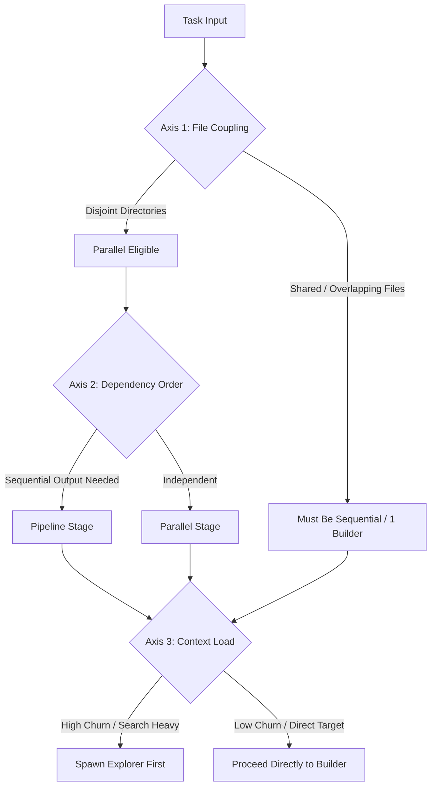

# Dynamic Task Decomposition Matrix

This document provides the formal decision rules used by the Super Agent to decompose arbitrary runtime tasks into subagent configurations.

## 1. The Three Structural Axes

Every inbound task must be evaluated along three orthogonal axes:

### Axis 1: File Coupling (Risk of Merge Conflicts)
- **High Coupling**: Subtasks require modifying the same files, same configuration objects, or same database migrations.
  - *Constraint*: **Never parallelize write agents on overlapping files.** Assign the work to a single Builder sequentially.
- **Low Coupling (Disjoint)**: Subtasks reside in mutually exclusive directory trees (e.g., `src/backend/` vs. `src/frontend/` vs. `tests/`).
  - *Constraint*: Parallel write subagents are permitted, each using `Workspace: 'branch'`.

### Axis 2: Dependency Order (DAG Topology)
- **Pipelines**: Task $B$ requires the schema, API signature, or outputs produced by Task $A$.
  - *Rule*: Partition into distinct execution phases. Run Task $A$ to completion before instantiating Task $B$.
- **Embarrassingly Parallel**: Independent analysis or implementations across multiple modules.
  - *Rule*: Spawn concurrent subagents within a single phase, subject to the concurrency ceiling.

### Axis 3: Context & Token Churn
- **High Token Churn**: Tasks requiring broad AST grep queries, thousands of line reads, multi-page web search summaries, or huge test logs.
  - *Rule*: Offload to a throwaway `Explorer` or `Validator` subagent with `Workspace: 'inherit'`. This keeps the Super Agent's main context window clean and free of noise.

---

## 2. Sizing Rules (Determining Subagent Count)

| Scenario Profile | Sizing Decision | Phase Structure | Rationale |
| :--- | :--- | :--- | :--- |
| **Focused Task** (Single module, clear bugfix, local edit) | **1 Subagent** (Builder) | Phase 1: 1 Builder | Zero coordination tax. Splitting simple tasks adds latency and token overhead. |
| **High Uncertainty** (Large unfamiliar repo, ambiguous error) | **1 Explorer $\rightarrow$ 1 Builder** | Phase 1: 1 Explorer Phase 2: 1 Builder | Prevents Builders from making premature, incorrect edits before facts are mapped. |
| **Disjoint Multi-Module** (Full-stack feature, independent components) | **2–3 Builders** (Max 3) | Phase 1: Optional Explorer Phase 2: 2–3 Builders Phase 3: 1 Validator | Maximizes throughput while keeping git merge complexity within deterministic bounds. |
| **Large-Scale Exploration / Audit** (Security audit, dependency review) | **1–2 Explorers** | Phase 1: 1–2 Explorers (parallel) Phase 2: 1 Synthesizer | Read-only analysis has zero write-conflict risk. |

### The "Rule of Three" Concurrency Ceiling
- The Super Agent must **never** run more than **3 concurrent write subagents** (`Builders`) simultaneously.
- When a task spans more than 3 modules, group modules into clusters and execute them across sequential phases.

---

## 3. Example Decomposition Scenarios

### Scenario A: "Upgrade database schema and update API endpoints to support OAuth"
1. **Analysis**:
   - Schema migration must complete before endpoint models can be written (Sequential Pipeline).
   - Backend routes and frontend login button touch disjoint code (Parallel Eligible).
2. **Allocation**:
   - **Phase 1**: 1 Builder (`Workspace: 'branch'`) $\rightarrow$ Implement database schema migration.
   - **Phase 2**: 2 Builders (`Workspace: 'branch'`) $\rightarrow$ Builder 1: API OAuth routes; Builder 2: UI Login Component.
   - **Phase 3**: 1 Validator $\rightarrow$ Run end-to-end OAuth test suite.

### Scenario B: "Investigate why CI fails on Windows and fix it"
1. **Analysis**:
   - Root cause is unknown (High Uncertainty).
   - High log churn expected (Context Risk).
2. **Allocation**:
   - **Phase 1**: 1 Explorer (`Workspace: 'inherit'`) $\rightarrow$ Read CI logs, check Windows environment differences, identify failing test files.
   - **Phase 2**: 1 Builder (`Workspace: 'branch'`) $\rightarrow$ Implement path or environment fix identified in Phase 1.
   - **Phase 3**: 1 Validator $\rightarrow$ Run the failing test locally in Windows PowerShell.
